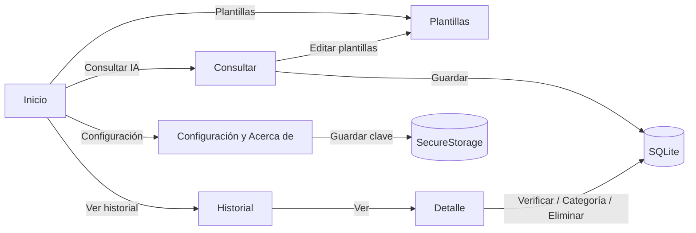

# 01. Requisitos y diseño

## Problema

Los estudiantes usan asistentes de IA sin conservar lo que preguntaron, sin distinguir qué respuestas verificaron y, a veces, compartiendo datos que no deberían. **AsistenteIA** ofrece un espacio académico para consultar un modelo de IA con plantillas orientadas al estudio. La app guarda un historial local, permite marcar las respuestas contrastadas con fuentes y recuerda los límites y riesgos de la IA.

**Usuarios:** estudiantes universitarios.
**Restricciones:** la app no puede incluir claves secretas en el código, funciona en Windows o Android y depende de un proveedor externo de IA (Pollinations).

## Historias de usuario

| ID | Historia | Criterios de aceptación |
|---|---|---|
| HU01 | Como estudiante quiero escribir una pregunta y recibir una respuesta de IA para resolver dudas. | Con un prompt válido y una clave válida, la respuesta aparece y el estado indica "Respuesta recibida" (P01). |
| HU02 | Como estudiante quiero que la app me avise si mi consulta está vacía o es muy larga para no gastar solicitudes. | Un prompt vacío o con menos de 5 caracteres no se envía y se muestra un mensaje (P02). Si supera 2000 caracteres, se rechaza. |
| HU03 | Como estudiante quiero usar plantillas (explicar, resumir, preguntas de repaso) y editarlas. | Hay plantillas iniciales. Puedo crear, editar y eliminar plantillas, y la plantilla elegida se aplica al prompt. |
| HU04 | Como estudiante quiero ver claramente si la app está consultando, si falló o si no hay internet. | Aparece un indicador de carga. Los errores 401, 402, 429 y 5xx, el tiempo agotado y la falta de conexión muestran mensajes comprensibles (P03, P04, P05). |
| HU05 | Como estudiante quiero cancelar una consulta que tarda mucho. | El botón Cancelar detiene la solicitud sin bloquear la interfaz (P06). |
| HU06 | Como estudiante quiero guardar consultas y respuestas para repasarlas después. | Guardar crea un registro en SQLite que aparece en el historial (P07) y que sigue ahí al reiniciar la app (P09). |
| HU07 | Como estudiante quiero buscar, filtrar, ver en detalle y eliminar conversaciones guardadas. | El historial permite buscar por texto y filtrar por categoría. Eliminar pide confirmación (P08). El detalle muestra prompt, respuesta, fecha, categoría y estado de verificación. |
| HU08 | Como estudiante quiero marcar una respuesta como verificada después de contrastarla con fuentes. | El detalle tiene un botón para marcar o desmarcar, y el cambio se guarda (actualización del CRUD). |
| HU09 | Como estudiante quiero registrar mi clave sin que se vea en pantalla. | La clave se escribe en un campo de contraseña y se muestra enmascarada (••••1234). Se puede eliminar, con confirmación. |
| HU10 | Como estudiante quiero saber para qué sirve la app, quién la hizo, qué pasa con mis datos y qué límites tiene. | La sección Acerca de explica finalidad, autoría, fuentes, privacidad y limitaciones. |

## Requisitos funcionales y trazabilidad

| Código | Requisito | Implementación |
|---|---|---|
| RF01 | Ingresar una pregunta o instrucción | `Views/ChatPage.xaml` (Editor enlazado a `ChatViewModel.Prompt`) |
| RF02 | Validar contenido y longitud (5–2000) | `AiService.ValidatePrompt`, usado en `ChatViewModel.AskAsync` antes de enviar |
| RF03 | Solicitud POST a la API REST | `AiService.SendChatAsync` → `POST chat/completions` |
| RF04 | Estados de carga, respuesta, error y sin conexión | `ChatViewModel.IsBusy/StatusMessage/IsError`, `AiServiceException`, `IConnectivity` |
| RF05 | Guardar consulta y respuesta en SQLite | `ChatViewModel.SaveAsync` → `DatabaseService.SaveAsync` |
| RF06 | Consultar, filtrar, ver detalle y eliminar | `HistoryViewModel`, `DetailViewModel`, `DatabaseService.GetConversationsAsync/DeleteAsync` |
| RF07 | Plantillas académicas editables | `TemplatesViewModel`, `PromptTemplate`, tabla `PromptTemplate` en SQLite |
| RF08 | Registrar o actualizar la clave sin mostrarla | `SettingsPage` (`Entry IsPassword="True"`), `ApiKeyService` (SecureStorage) |
| RF09 | Acerca de: finalidad, autoría, fuentes, privacidad y límites | Sección "Acerca de AsistenteIA" en `SettingsPage.xaml` |
| RF10 | Funciona en Windows o Android | Destinos `net10.0-windows10.0.19041.0` y `net10.0-android`. Pruebas en Windows |

## Flujo de navegación



Las cuatro pantallas principales están en la barra de pestañas de Shell. **Detalle** (`detail?id=`) y **Plantillas** (`templates`) son rutas registradas en `AppShell.xaml.cs`.

## Wireframes

```
┌──────────── Consultar IA ────────────┐   ┌────────────── Historial ─────────────┐
│ [Plantilla ▼]  [Categoría ▼] [Editar]│   │ [🔍 Buscar............] [Categoría ▼]│
│ ┌──────────────────────────────────┐ │   │ 3 conversaciones                     │
│ │ Escriba una consulta académica…  │ │   │ ┌──────────────────────────────────┐ │
│ └──────────────────────────────────┘ │   │ │ Explica qué es una API REST…     │ │
│ No incluya datos personales   0/2000 │   │ │ Una API REST es…   [Ver][Eliminar]│ │
│ [Consultar][Cancelar][Guardar][Limpiar]│ │ │ 15/10/2026 · Estudio · Verificada │ │
│ ◌ Consultando el servicio…           │   │ └──────────────────────────────────┘ │
│ ┌─ Respuesta ──────────────────────┐ │   └──────────────────────────────────────┘
│ │ …                                │ │   ┌────────────── Detalle ───────────────┐
│ │ ⚠ Verifique con fuentes          │ │   │ Fecha · Modelo · [Categoría ▼]       │
│ └──────────────────────────────────┘ │   │ Prompt enviado / Respuesta           │
└──────────────────────────────────────┘   │ ⚠ Sin verificar                      │
                                           │ [Marcar verificada][Copiar][Eliminar]│
                                           └──────────────────────────────────────┘
```

Capturas reales de cada pantalla: carpeta [evidencias](evidencias/).
