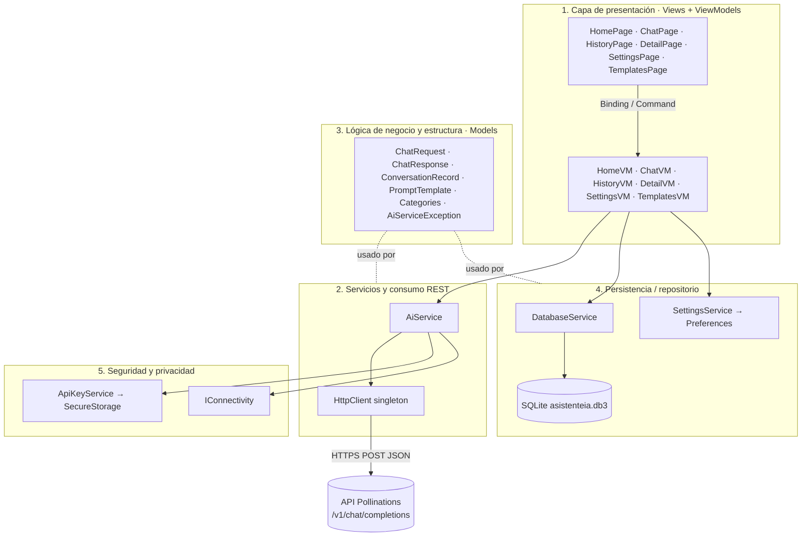
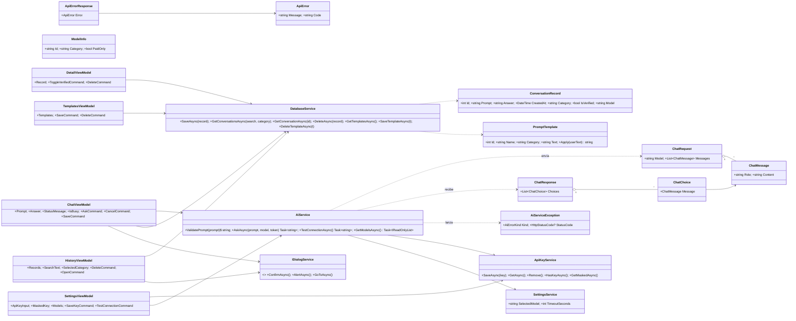

# 02. Arquitectura del sistema

AsistenteIA es un asistente académico con inteligencia artificial que consume servicios REST y está organizado en módulos. La solución se divide en cinco componentes. Cada uno corresponde a carpetas y clases concretas del proyecto `AsistenteIA/`.

---

## 1. Capa de presentación (cliente)

Es la interfaz donde el usuario escribe sus consultas y ve las respuestas de la IA. Usa XAML con el patrón **MVVM**: la vista solo enlaza propiedades y comandos y nunca hace solicitudes HTTP.

| Pantalla (`Views/`) | ViewModel (`ViewModels/`) | Función |
|---|---|---|
| `HomePage` | `HomeViewModel` | Propósito de la app, accesos rápidos, resumen del historial y recomendaciones de uso |
| `ChatPage` | `ChatViewModel` | Escribir la consulta, elegir plantilla y categoría, consultar, cancelar, guardar |
| `HistoryPage` | `HistoryViewModel` | Listar, buscar, filtrar por categoría y eliminar conversaciones |
| `DetailPage` | `DetailViewModel` | Ver prompt, respuesta, fecha, categoría y verificación. Marcar como verificada |
| `SettingsPage` | `SettingsViewModel` | Clave, modelo, tiempo de espera y sección Acerca de |
| `TemplatesPage` | `TemplatesViewModel` | CRUD de plantillas de prompts |

- **Navegación:** `AppShell` con un `TabBar` (Inicio, Consultar, Historial, Configuración) y rutas registradas (`detail?id=`, `templates`).
- **Estado y comandos:** CommunityToolkit.Mvvm (`[ObservableProperty]`, `[RelayCommand]` con `CanExecute`).
- **Diseño adaptable:** `FlexLayout Wrap`, `ScrollView` y estilos en `Resources/Styles`.
- **Accesibilidad:** `SemanticProperties` y `AutomationId` en los controles.
- **Desacople:** los diálogos y la navegación se piden por `IDialogService`, así los ViewModels no dependen de las páginas.

## 2. Capa de servicios y consumo REST

Conecta el cliente con el modelo de IA mediante una API REST compatible con OpenAI Chat Completions. El proveedor se elige en Configuración: **Pollinations** o **Google Gemini** (`Models/AiProvider.cs`).

| Clase | Responsabilidad |
|---|---|
| `AiService.AskAsync` | Valida el prompt, arma `ChatRequest` (mensaje *system* académico + mensaje *user*) y devuelve la respuesta del modelo. `PlainText` quita el Markdown al copiar, compartir y en las vistas previas del historial |
| `AiService.SendChatAsync` | Revisa la conectividad, lee la clave del proveedor activo, envía `POST {URL base}chat/completions` con `Authorization: Bearer` y `JsonContent`, reintenta hasta 2 veces ante 503/429 (esperas de 2 y 4 s), controla el tiempo de espera y la cancelación, y deserializa `ChatResponse` |
| `AiService.CreateHttpErrorAsync` | Convierte los códigos HTTP (400 de clave inválida de Google, 401, 402, 404, 429, 5xx…) en `AiServiceException` con un mensaje comprensible más el motivo del proveedor (acepta errores en objeto o en arreglo JSON) |
| `AiService.TestConnectionAsync` | Consulta breve para el botón "Probar conexión" |
| `AiService.GetModelsAsync` | `GET {URL base}models`, filtra los modelos de texto del proveedor y usa una lista local si falla |
| `HttpClient` (singleton en `MauiProgram`) | Reutiliza conexiones. La URL completa la arma `AiService` según el proveedor |

El detalle de solicitud, respuesta y códigos HTTP está en [03-api-rest.md](03-api-rest.md).

## 3. Capa de lógica de negocio y estructura

Contiene las reglas del dominio, los modelos y las decisiones de diseño.

**Reglas de negocio**
- La consulta debe tener entre 5 y 2000 caracteres (`AiService.ValidatePrompt`). Se valida en el ViewModel antes de enviar y otra vez en el servicio.
- La plantilla elegida se aplica reemplazando `{consulta}` (`PromptTemplate.Apply`). Si el resultado supera 2000 caracteres, se rechaza.
- Solo se guarda una respuesta recibida y no se guarda dos veces (`ChatViewModel.CanSave`).
- Una respuesta solo se marca como verificada por acción explícita del usuario después de contrastarla con fuentes.
- El tiempo de espera es configurable (de 1 a 120 s) y distinto de la cancelación manual.

### Diagrama de clases

### Recorrido de una consulta (XAML → ViewModel → REST → JSON → SQLite)

1. **XAML.** En `ChatPage`, el `Editor` está enlazado a `Prompt` y el botón Consultar a `AskCommand`.
2. **ViewModel.** `ChatViewModel.AskAsync` valida, aplica la plantilla, crea un `CancellationTokenSource` y pone `IsBusy = true`.
3. **REST.** `AiService.SendChatAsync` envía el POST con Bearer y el JSON.
4. **JSON.** `ReadFromJsonAsync<ChatResponse>` devuelve `choices[0].message.content`. Si hay error HTTP, se lanza `AiServiceException`.
5. **Vista.** `Answer` y `StatusMessage` cambian y el binding refresca la pantalla.
6. **SQLite.** El comando Guardar crea un `ConversationRecord` y llama a `DatabaseService.SaveAsync` (`InsertAsync`).

### Decisiones técnicas

| Decisión | Justificación |
|---|---|
| MVVM + inyección de dependencias | Separa la interfaz, el estado y el acceso a datos. Todo se registra en `MauiProgram.cs`: servicios como singleton, ViewModels y páginas como transient. |
| Un solo `HttpClient` | Evita el agotamiento de sockets y centraliza la URL base. |
| Tiempo de espera propio con CTS enlazado | Distingue el tiempo agotado (P05) de la cancelación manual (P06). |
| Errores tipados (`AiErrorKind`) | Mensajes claros por cada caso sin exponer detalles técnicos ni la clave. |
| Proveedor seleccionable, modelo configurable y lista dinámica | Reduce la dependencia del proveedor. Se agregó Google Gemini cuando el equipo obtuvo una clave de Google (F5). |
| Reintento automático ante 503/429 | En las pruebas, Gemini respondió 503 por saturación con frecuencia. Dos reintentos con espera creciente resuelven la mayoría sin intervención (F9). |
| Markdown interpretado en la vista, no en el prompt | Pedirle al modelo "sin Markdown" hizo que omitiera las tildes (F8). La respuesta se guarda tal como llega y `MarkdownToFormattedStringConverter` la muestra con títulos, negritas y viñetas (F16). `PlainText` quita `#`, `**`, `---` para copiar, compartir y las vistas previas. |
| Identidad visual propia | Paleta verde azulado con contraste WCAG AA verificado en tema claro y oscuro, fuente Inter, íconos Material Icons Round (fuentes con licencia OFL / Apache 2.0), ícono y splash propios. Los colores de estado usan `AppThemeBinding` + `DataTrigger` sobre `IsError` (F17). |
| Consulta en formato de conversación | `ChatPage` muestra cada consulta como burbuja del usuario y la respuesta como burbuja de la IA (`ChatExchangeViewModel`). Cada respuesta tiene Copiar, Compartir y Guardar; `IClipboard` e `IShare` se inyectan desde `MauiProgram`. |
| Plantillas en SQLite | Son editables (RF07) y persisten. |
| Bindings compilados (`x:DataType`) + XAML `SourceGen` | Errores de enlace detectados al compilar y mejor rendimiento. |
| Diseño responsive | `FlexLayout Wrap` en filas de controles, `MaximumWidthRequest="1000"` en todas las páginas, lista y formulario lado a lado en pantallas anchas, `Grid` con columna `*` para textos largos. Verificado en 400, 820 y 1400 px (F3, F11–F15). |

## 4. Capa de persistencia / repositorio

Controla el acceso a los datos locales: consultas, historial, plantillas y configuración.

| Dato | Almacén | Clase | Operaciones |
|---|---|---|---|
| Historial de conversaciones | SQLite, tabla `ConversationRecord` | `DatabaseService` | Crear (`InsertAsync`), consultar con búsqueda y filtro por categoría (`Table<T>().Where().ToListAsync`), actualizar verificación y categoría (`UpdateAsync`), eliminar (`DeleteAsync`) |
| Plantillas de prompts | SQLite, tabla `PromptTemplate` | `DatabaseService` | CRUD completo y seis plantillas iniciales |
| Proveedor, modelo (por proveedor) y tiempo de espera | `Preferences` | `SettingsService` | Lectura y escritura |
| Clave de la API | `SecureStorage` | `ApiKeyService` | Ver la capa 5 |

- **Ubicación:** `FileSystem.AppDataDirectory/asistenteia.db3`. Persiste entre reinicios (P09).
- **Inicialización:** perezosa y segura entre hilos (`SemaphoreSlim`), en el primer acceso. Crea tablas e índice y siembra las plantillas.
- **Repositorio de código:** Git con commits descriptivos por fase. `.gitignore` excluye `bin/`, `obj/`, `.vs/` y archivos de secretos.

Esquema SQL completo en [07-manual-tecnico.md](07-manual-tecnico.md).

## 5. Módulo de seguridad y privacidad

Maneja los datos de forma segura y mitiga los riesgos de privacidad. La matriz completa está en [04-matriz-riesgos.md](04-matriz-riesgos.md).

| Control | Implementación |
|---|---|
| Credencial fuera del código | La clave la ingresa el usuario. No hay claves en el código, la configuración ni el repositorio (verificado con `git grep`). |
| Almacenamiento cifrado | `ApiKeyService` usa `SecureStorage` (DPAPI en Windows, Keystore en Android), con una ranura por proveedor. Al guardarla, la clave se limpia de espacios y caracteres invisibles. |
| La clave nunca se muestra | `Entry IsPassword="True"`, campo que se limpia al guardar y visualización enmascarada `••••1234`. No se registra en consola. |
| Transporte seguro | HTTPS. La clave va en el encabezado `Authorization`, nunca en la URL. |
| Minimización de datos | Avisos visibles para no ingresar datos personales. El historial vive solo en el dispositivo. No hay cuentas ni analítica. |
| Control del historial | Eliminación con confirmación (registro por registro) y eliminación de la clave con confirmación. |
| Uso responsable de la IA | Prompt de sistema académico ("no inventes fuentes"), aviso de verificación en cada respuesta, marca de "verificada" y sección de limitaciones. |
| Robustez | Revisión de conectividad, manejo de todos los códigos HTTP, tiempo de espera y cancelación. La app no se cierra ante fallos de red. |
| Dependencias | `dotnet list package --vulnerable` sin hallazgos (SQLite nativo fijado en 2.1.14). |
| Control de acceso | No aplica: es una app personal y local, sin inicio de sesión. El acceso al servicio de IA lo autoriza la clave personal de cada usuario. |
