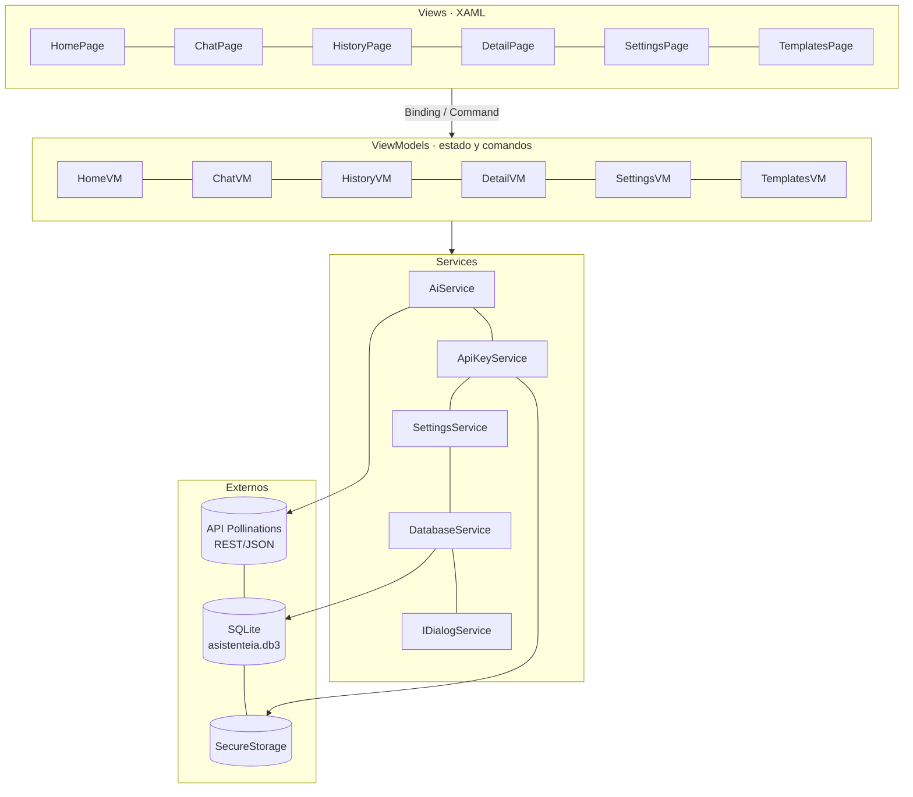

# 02. Arquitectura y decisiones técnicas

## Capas (MVVM)

| Carpeta | Responsabilidad |
|---|---|
| `Models` | Clases que representan el JSON (`ChatRequest`, `ChatResponse`, `ApiErrorResponse`, `ModelListResponse`) y las entidades locales (`ConversationRecord`, `PromptTemplate`). |
| `Services` | Acceso a la API (`AiService`), clave segura (`ApiKeyService`), preferencias (`SettingsService`), base de datos (`DatabaseService`) y diálogos y navegación (`IDialogService`). |
| `ViewModels` | Estado observable y comandos. No conocen las vistas: los diálogos se piden por `IDialogService`. |
| `Views` | Solo XAML y enlaces. El code-behind recibe el ViewModel por constructor y llama a `LoadCommand` en `OnAppearing`. |

## Recorrido completo de una consulta (XAML → ViewModel → REST → JSON → SQLite)

1. **XAML.** En `ChatPage.xaml`, el `Editor` está enlazado a `Prompt` y el botón Consultar a `AskCommand`.
2. **ViewModel.** `ChatViewModel.AskAsync` valida con `AiService.ValidatePrompt`, aplica la plantilla (`PromptTemplate.Apply`), crea un `CancellationTokenSource` y pone `IsBusy = true`. El indicador de carga se activa y Cancelar se habilita.
3. **Servicio REST.** `AiService.SendChatAsync` revisa la conectividad (`IConnectivity`), lee la clave de `SecureStorage`, arma un `HttpRequestMessage` POST a `chat/completions` con el encabezado `Authorization: Bearer` y un cuerpo `JsonContent.Create(ChatRequest)`.
4. **JSON.** Si la respuesta es exitosa, se deserializa con `ReadFromJsonAsync<ChatResponse>` y se toma `choices[0].message.content`. Si el código HTTP es de error, `CreateHttpErrorAsync` lee `ApiErrorResponse` y lo convierte en una `AiServiceException` con un mensaje para el usuario.
5. **Vista.** `Answer` y `StatusMessage` cambian, y el binding actualiza la pantalla.
6. **SQLite.** Guardar ejecuta `SaveAsync`, que crea un `ConversationRecord` y llama a `DatabaseService.SaveAsync` (`InsertAsync`). El historial lo lee con `Table<ConversationRecord>().Where(...).OrderByDescending(...).ToListAsync()`.

## Inyección de dependencias (`MauiProgram.cs`)

| Registro | Ciclo de vida | Motivo |
|---|---|---|
| `HttpClient` (BaseAddress `https://gen.pollinations.ai/v1/`) | Singleton | Reutilizar conexiones y evitar el agotamiento de sockets. |
| `IConnectivity`, `IPreferences` | Singleton | APIs de la plataforma inyectables. |
| `ApiKeyService`, `SettingsService`, `AiService`, `DatabaseService`, `IDialogService` | Singleton | Sin estado por pantalla; una sola conexión SQLite. |
| ViewModels y Pages | Transient | Estado nuevo por cada navegación. |

## Decisiones técnicas

| Decisión | Justificación |
|---|---|
| La clave la ingresa el usuario y se guarda en `SecureStorage` | Cumple el principio técnico de la guía: ninguna clave en el código ni en el repositorio. En Windows se cifra con DPAPI y en Android con Keystore. |
| Tiempo de espera propio en `AiService` (CTS enlazado) en lugar de solo `HttpClient.Timeout` | Permite distinguir **cancelación del usuario** (P06) de **tiempo agotado** (P05) y mostrar mensajes distintos. El valor se configura en la app. |
| Errores tipados (`AiServiceException` con `AiErrorKind`) | El ViewModel muestra mensajes claros (401 clave inválida, 402 saldo agotado, 429 límite, 5xx servicio caído) sin exponer detalles técnicos ni la clave. |
| Validación en el ViewModel antes de llamar al servicio | No se gasta una solicitud HTTP en un prompt inválido (P02). El servicio vuelve a validar por defensa. |
| Modelo configurable y lista desde `GET /v1/models` | Reduce la dependencia del proveedor: si cambian los modelos, la app los muestra sin recompilar. Si no hay conexión, usa una lista local. |
| Plantillas en SQLite | Así son editables (RF07) y persisten como el historial. |
| `IDialogService` | Los ViewModels no dependen de `Page` ni de `Shell`, lo que mantiene la separación MVVM. |
| Bindings compilados (`x:DataType`) e inflado XAML `SourceGen` | Errores de enlace detectados al compilar y mejor rendimiento. |
| `FlexLayout` con `Wrap` en filas de botones y selectores | La interfaz se adapta a pantallas angostas. Lo detectó la prueba P10 y se corrigió. |
| `SQLitePCLRaw.lib.e_sqlite3` 2.1.14 fijado | La versión transitiva 2.1.11 tenía una vulnerabilidad alta conocida (GHSA-2m69-gcr7-jv3q). |
