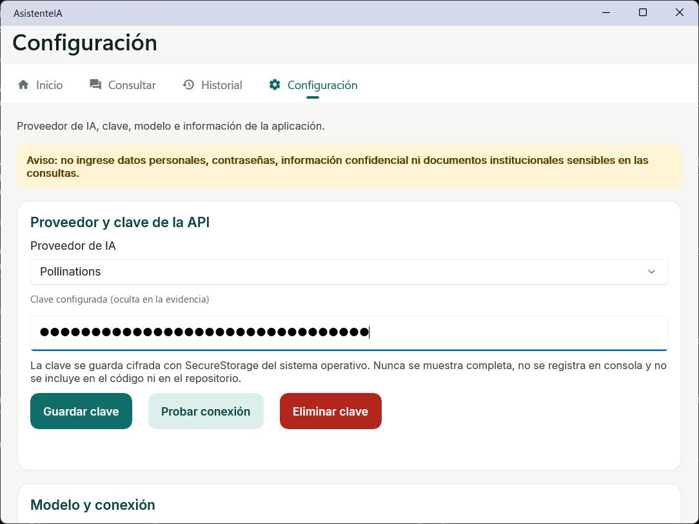
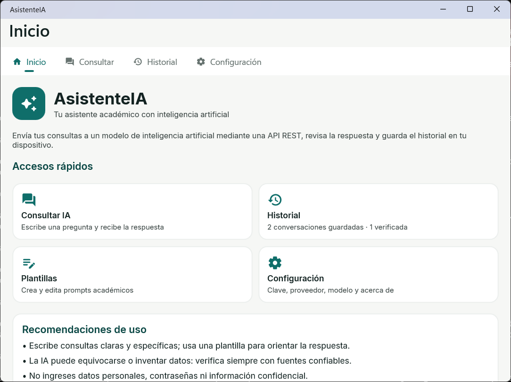
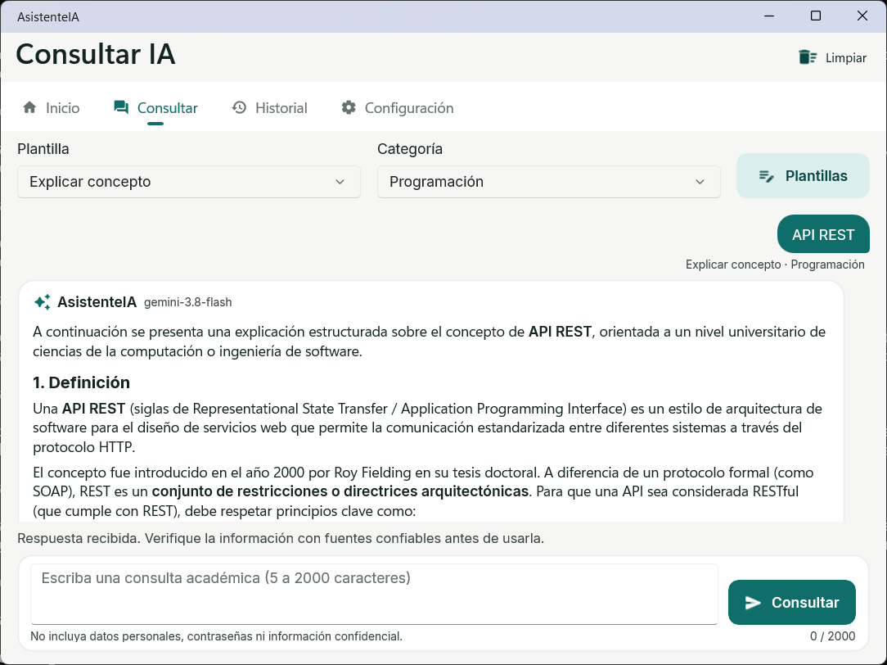

# 06. Manual de usuario: AsistenteIA

> Versión en PDF con capturas: [manuales/Manual-de-usuario-AsistenteIA.pdf](manuales/Manual-de-usuario-AsistenteIA.pdf)

## Tabla de contenidos

1. [Introducción](#1-introducción)
2. [Acceso a la plataforma](#2-acceso-a-la-plataforma)
3. [Uso del asistente de IA](#3-uso-del-asistente-de-ia)
4. [Privacidad y seguridad](#4-privacidad-y-seguridad)
5. [Preguntas frecuentes (FAQ) y soporte](#5-preguntas-frecuentes-faq-y-soporte)

---

## 1. Introducción

### 1.1 Propósito del sistema

AsistenteIA es una aplicación para estudiantes que permite hacer preguntas académicas a un modelo de inteligencia artificial y recibir respuestas claras: explicaciones de conceptos, resúmenes, preguntas de repaso, revisión de redacción o explicación de código. Además, la app:

- ofrece **plantillas** que orientan la pregunta según lo que necesites;
- **guarda** las consultas y respuestas que elijas para repasarlas después;
- te deja **marcar como verificadas** las respuestas que contrastaste con fuentes confiables.

> La IA es un apoyo para aprender, no una autoridad. Sus respuestas pueden contener errores.

### 1.2 Requisitos mínimos

AsistenteIA es una aplicación instalable, no una página web, así que no necesita navegador.

| Requisito | Detalle |
|---|---|
| Sistema operativo | Windows 10 (versión 1809) o superior, o Android 5.0 o superior |
| Conexión a internet | Necesaria para consultar la IA. El historial y las plantillas se pueden ver sin conexión. |
| Clave de la API | Una clave personal de Google Gemini (AI Studio) o de Pollinations |
| Espacio | Menos de 200 MB |

---

## 2. Acceso a la plataforma

### 2.1 Inicio de sesión / registro

La app **no requiere cuenta ni contraseña**: se abre directamente. La única credencial es la **clave de la API**, que se registra una sola vez. Puede usar uno de dos proveedores:

| Proveedor | Dónde obtener la clave | Prefijo |
|---|---|---|
| Google Gemini | <https://aistudio.google.com/apikey> | `AIza…` |
| Pollinations | <https://enter.pollinations.ai/keys> | `sk_…` |

1. Abra la pestaña **Configuración** y, en **Proveedor de IA**, elija el proveedor de su clave. Si la clave tiene un prefijo conocido, la app lo selecciona sola al guardar.
2. Pegue su clave en el campo "Pegue aquí su clave". Se verán puntos (•••), no el texto.
3. Pulse **Guardar clave**. Aparecerá "Clave configurada: ••••XXXX" (solo los últimos 4 caracteres).
4. Pulse **Probar conexión**. Si todo está bien, verá "Conexión exitosa…".

### 2.2 Interfaz principal

La barra superior tiene cuatro pestañas: **Inicio**, **Consultar**, **Historial** y **Configuración**.

La pantalla de **Inicio** muestra:

- el propósito de la aplicación;
- un aviso amarillo si todavía no hay clave configurada;
- **accesos rápidos** en tarjetas: Consultar IA, Historial (con el resumen de conversaciones guardadas y verificadas), Plantillas y Configuración;
- recomendaciones de uso responsable.

En pantallas pequeñas, las pestañas que no caben se agrupan en el botón **⋯**.

---

## 3. Uso del asistente de IA

### 3.1 Realizar una consulta

1. Abra **Consultar**.
2. Elija una **Plantilla**:
   - *Consulta libre:* envía su texto tal cual.
   - *Explicar concepto:* definición, ejemplo y error común.
   - *Resumir texto:* máximo cinco viñetas.
   - *Preguntas de estudio:* cinco preguntas con respuesta.
   - *Explicar código C#:* paso a paso y una mejora.
   - *Revisar redacción:* ortografía y claridad.
3. Elija una **Categoría** (General, Programación, Matemáticas, Ciencias, Redacción, Estudio).
4. Escriba su pregunta, entre 5 y 2000 caracteres. El contador inferior muestra la longitud.
5. Pulse **Consultar**. Su pregunta aparece como burbuja a la derecha; mientras espera, la burbuja de la IA muestra "Pensando la respuesta…" y el mensaje de estado dice "Consultando el servicio…".
6. Si tarda demasiado, pulse **Cancelar** (aparece en lugar de Consultar mientras se espera). Si la consulta se cancela o falla, su texto vuelve al editor para reintentar.

Para crear o modificar plantillas, pulse **Plantillas**. Seleccione una de la lista para editarla o pulse **Nueva**. Use `{consulta}` donde debe ir su pregunta.

### 3.2 Interpretación de resultados

- La respuesta aparece en la burbuja de **AsistenteIA**, con títulos, negritas y viñetas cuando el modelo los usa. Las consultas de la sesión se acumulan como una conversación.
- Debajo hay un aviso: *"Respuesta generada por IA: puede contener errores. Contrástela con fuentes confiables…"*.
- El mensaje de estado indica el resultado: en gris si fue correcto, en rojo si hubo un problema. También muestra el modelo usado.
- **La IA no entrega fuentes verificadas.** Si menciona autores o referencias, búsquelas antes de citarlas.
- Debajo de cada respuesta: **Copiar** (al portapapeles), **Compartir** (con otra aplicación, incluye el aviso de verificación) y **Guardar** (la envía al **Historial**; el botón cambia a *Guardada*).
- **Limpiar** (arriba a la derecha) borra la conversación de la pantalla para empezar de nuevo; no afecta el historial.

En **Historial**, toque una tarjeta para abrir el detalle. Para eliminar use el ícono de papelera o, en el teléfono, deslice la tarjeta hacia la izquierda. En el detalle puede:

- **Marcar como verificada** la respuesta, después de contrastarla.
- Cambiar la **categoría**.
- **Copiar** la respuesta al portapapeles o **Compartirla**.
- **Eliminar** la conversación.

### 3.3 Filtros y opciones avanzadas

| Opción | Dónde | Qué hace |
|---|---|---|
| Búsqueda por texto | Historial, buscador | Filtra por palabras de la pregunta o la respuesta |
| Filtro por categoría | Historial, selector "Categoría" | Muestra solo esa categoría (o "Todas") |
| Orden por fecha | Historial | Las más recientes aparecen primero, con fecha y hora |
| Modelo de IA | Configuración | Elige entre los modelos gratuitos del proveedor. Unos son más rápidos y otros más detallados. |
| Tiempo máximo de espera | Configuración | Segundos (de 1 a 120) antes de cancelar automáticamente una consulta. Con el plan gratuito de Gemini se recomienda 120 s |
| Plantillas | Consultar → Plantillas | Orientan el tipo y el nivel de detalle de la respuesta |

---

## 4. Privacidad y seguridad

### 4.1 Manejo de datos e historial

| Dato | Dónde queda | Quién lo ve |
|---|---|---|
| Su pregunta | Se envía al proveedor de IA elegido (Google Gemini o Pollinations) para generar la respuesta | El proveedor, según sus políticas |
| Historial guardado | Solo en su dispositivo (base de datos local SQLite) | Solo usted |
| Clave de la API | Cifrada en el almacenamiento seguro del sistema (Windows DPAPI / Android Keystore) | Nadie: nunca se muestra completa ni se guarda en el código |

- La app **no tiene cuentas, no recopila datos personales y no usa analítica**.
- **No escriba** datos personales, contraseñas, información confidencial ni documentos institucionales sensibles en las consultas.

### 4.2 Borrar historial y ajustar la privacidad

- **Borrar una conversación:** Historial → **Eliminar** (o Detalle → **Eliminar**) → confirmar.
- **Borrar la clave del dispositivo:** Configuración → **Eliminar clave** → confirmar.
- **Guardar solo lo necesario:** las consultas **no se guardan automáticamente**, solo cuando usted pulsa **Guardar**.
- **Borrar todo:** al desinstalar la app se eliminan el historial, las plantillas y la clave.

---

## 5. Preguntas frecuentes (FAQ) y soporte

### 5.1 Solución de problemas comunes

| Mensaje o problema | Causa | Solución |
|---|---|---|
| "Escriba una consulta antes de enviar." / "…demasiado corta" | Pregunta vacía o con menos de 5 caracteres | Escriba una pregunta más completa |
| "La consulta supera 2000 caracteres." | Texto demasiado largo (contando la plantilla) | Acorte el texto o use "Consulta libre" |
| "Configure la clave de la API…" | No hay clave guardada | Vea la sección 2.1 |
| "Error 401…" / "Error 400: la clave no es válida para este proveedor…" | Clave incorrecta, revocada o de **otro proveedor** | Revise que el proveedor elegido coincida con la clave, o genere una nueva |
| "Error 402: el saldo… se agotó." | La clave no tiene saldo | Recargue saldo en Pollinations o use otra clave |
| "Error 429: demasiadas solicitudes o cuota agotada…" | Muchas consultas seguidas o se acabó la cuota gratuita del día | Espere (la cuota gratuita de Google se renueva cada día) o use otra clave o proveedor |
| "Error 503: el servicio… no está disponible (…high demand)" | El modelo está saturado. La app ya reintentó 2 veces de forma automática | Reintente en unos segundos o elija otro modelo en Configuración |
| "Sin conexión a internet…" / "No fue posible contactar el servicio" | Sin red o red bloqueada | Revise el Wi-Fi o los datos y reintente |
| "Tiempo de espera agotado (N s)…" | El modelo tardó más que el límite | Pulse Consultar de nuevo, aumente el tiempo en Configuración o elija un modelo más rápido |
| "Consulta cancelada por el usuario." | Pulsó Cancelar | Vuelva a enviar cuando quiera |
| La lista de modelos está corta | Sin conexión al abrir Configuración | Se muestra una lista de respaldo; vuelva a abrir la pestaña con conexión |

### 5.2 Canales de soporte

| Canal | Para qué |
|---|---|
| Equipo de desarrollo (integrantes del proyecto) | Errores de la aplicación y sugerencias. _Completar con los correos del equipo._ |
| Docente: Mg. Sandra Esperanza Sánchez Barragán | Dudas académicas sobre el proyecto |
| Pollinations: <https://enter.pollinations.ai> | Claves, saldo y estado del servicio de IA |

Al reportar un problema, incluya: el mensaje de estado exacto, el modelo usado, la hora y una captura **sin mostrar la clave**.
